# Phase 0 — Foundations · review report

Date: 2026-11-17 · Branch: `claude/linkyo-brand-identity-mkz3tk`

## 0. Update — Direction D "Poster", built from your references

You answered the direction question with seven screenshots of two public creator pages (one light, one dark) and
"like this". Poster is that structure in Linkyo's own design ([ADR 0011](../../DECISIONS/0011-poster-direction.md)):

- **Hero:** a full-bleed portrait that fades into the page, the name set like a gig poster (Anton), bio, monochrome
  platform icons.
- **Sections:** content grouped under bold titles. A "header" block opens a section, tour/shorts/gallery blocks open
  their own, consecutive videos become a swipeable row and consecutive products a two-up grid — no containers to build.
- **Cards:** flat cards in one surface tone with the artwork beside the title. Releases open in place to show where to
  listen (`
`, works without JavaScript). Plain links show where they lead (domain or email).
- **Light and dark:** same layout. The page opens in the mode that matches the portrait; one switch in the dashboard.
  Monochrome accents now flip with the mode (black buttons on light, white on dark) instead of turning mid-grey.
- **Dashboard:** the page as an outline — section titles are rows (rename in place, hide, reorder), blocks under them
  are indented exactly as they group on the page, "Add section" is one click, live preview uses the real renderer.
- **Original, as the master prompt requires:** no code, text, images, logos or trademarks from the reference product.
  Not copied on purpose: the sticky "register free" bar (it covers the creator's content) and the "cookie settings"
  link (Linkyo creator pages set no cookies — the link is now gone from every direction).

Routes: `/de/directions/poster` (dark, Mila's dark portrait) · `/ar/directions/poster` (light, Nour's light portrait) ·
`?mode=light|dark` · `/directions/poster/dashboard`. Captures: `creator/poster-*`, `dashboard/poster-*`,
`overview-*`.

## 0b. Update — five Poster templates (from your five recordings)

Same content, five looks ([ADR 0012](../../DECISIONS/0012-poster-templates.md)): **Nocturne** (black), **Daylight**
(white), **Marquee** (your logo over a blurred photo), **Pulse** (the whole page in your color, photo toned to match —
new "vivid" palette mode, AA-tested on 2,000 random colors) and **Atelier** (warm paper, serif name, caps titles).
The page starts in the template that fits the portrait (dark photo → Nocturne, light → Daylight); the dashboard picks
templates with live mini previews; the prototype toolbar switches them (`?template=`).

New on every template: month tabs for shows ("All" first, ARIA tabs), two-row swipe rails for long runs (mixes,
episodes), partner tiles, "Anzeige/Ad" labels on affiliate links, video titles on the frame, Shorts badges, a hero that
softens and fades on scroll and a compact bar with share (CSS scroll-driven animations, no JavaScript, reduced-motion
safe). Captures: `creator/poster-<template>-<locale>-<width>.jpg`.

| Template page (mobile Lighthouse) | Perf | A11y | Best practices | LCP | CLS | 3rd-party |
|---|---|---|---|---|---|---|
| Nocturne (de, default) | 86 | 100 | 100 | 3.5 s | 0 | 0 |
| Daylight (ar, default) | 79 | 100 | 100 | 4.1 s | 0.001 | 0 |
| Pulse (de) | 78 | 100 | 100 | 4.5 s | 0.005 | 0 |
| Marquee (de) | 89 | 100 | 100 | 3.0 s | 0.005 | 0 |

Performance stays the one score below target: the App Router bundle (≈ 230 KB JS) dominates. ADR 0008 (static HTML +
~3 KB islands) is the fix and is scheduled first in Phase 1.

## 0c. Update — marketing home (linkyo.app)

A new homepage at `/de`, `/en`, `/ar` ([ADR 0013](../../DECISIONS/0013-marketing-home.md)), structured like the
reference you sent and built in Linkyo's own design: dark studio hero with a soft blue glow, username claim, three real
creator pages on phones (the centre one cycles through all five templates, the stage leans toward the mouse), three
promises as big numbers, a pausable template strip, a scroll story where the phone scrolls through a creator page, a
live paste-a-link demo, cookie-free analytics (sample data, labelled), pricing, FAQ and a final claim. All motion is CSS
(scroll-driven where possible), uses motion tokens and stops for reduced motion.

| Homepage (Lighthouse 13) | Perf | A11y | Best practices | LCP | CLS |
|---|---|---|---|---|---|
| Desktop (de) | 100 | 100 | 100 | 0.3 s | 0 |
| Mobile (de) | 89 | 100 | 100 | 3.7 s | 0 |
| Mobile (ar) | 76 | 100 | 100 | 4.4 s | 0 |

E2E: 7 homepage tests (claim validation, paste demo, marquee pause, FAQ, sections, 0 third-party requests/cookies,
phone popover menu) + axe on the homepage in 3 languages × light/dark × desktop/mobile. Total suite: 213 passing.
Captures: `home/home-<locale>-<width>-<scheme>.jpg`.

## 0d. Update — sign-up, log-in and the creator dashboard

Accounts and a complete dashboard ([ADR 0014](../../DECISIONS/0014-accounts-and-dashboard.md)), in **demo mode**: data is
saved only in the browser (clearly labelled), behind an `AccountStore` contract that the Supabase backend replaces in
Phase 1 without changing a screen.

- **Sign-up** (address from the homepage claim already filled in, live availability, password rules that turn green),
  **log-in** (returns where you were going), **reset**. Google/Apple shown as "At launch".
- **Welcome** in four steps — you, look, links, done — with the page building itself in a phone next to the form.
- **Home**: your link (copy, share, QR code as PNG), a six-step checklist that opens the right place, a 7-day overview.
- **Page**: the page top to bottom; tap to edit, drag or ⌥↑/⌥↓ to move, switch to hide, duplicate, delete with undo.
  One **Add** sheet everywhere (paste links, 16 block types, photo upload) and an **edit sheet for every block type**
  that sits beside the live page. One undo history for everything; autosave with a visible "Saved".
- **Design**: templates, your color (presets or any color; text stays readable), light/dark/colorful, 7 font pairings,
  6 button styles, 3 corner shapes. **Stats**: 7/30/90 days, change vs previous period, keyboard-readable daily chart
  with a table, top links, sources, countries, devices (sample data, labelled). **Settings**: profile, address, email,
  password, Impressum, appearance, language, export, delete.
- **Phone**: bottom tab bar with Add in the middle, sheets that slide up, previews full height; Arabic fully RTL.

| Desktop (de) | |
|---|---|
| 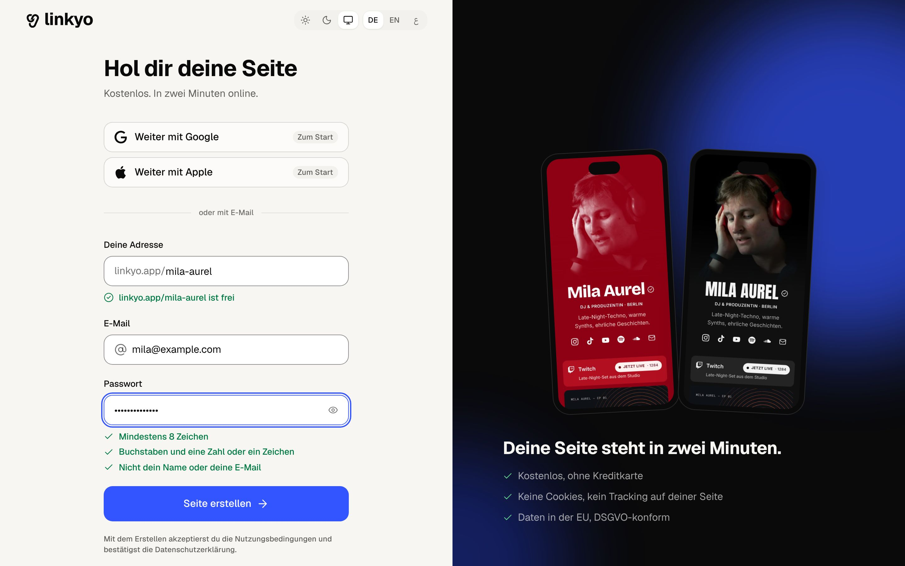 | 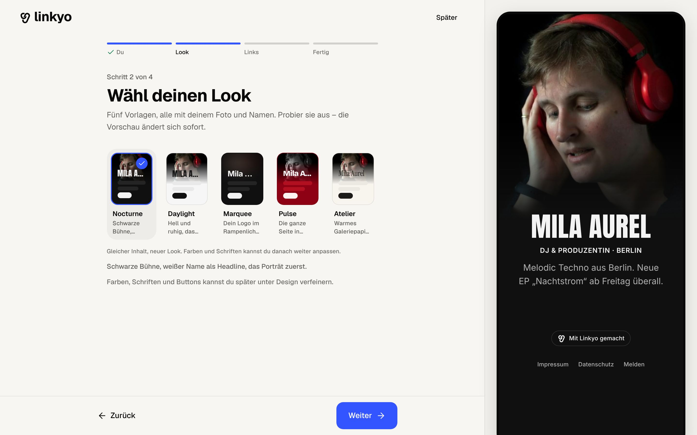 |
| 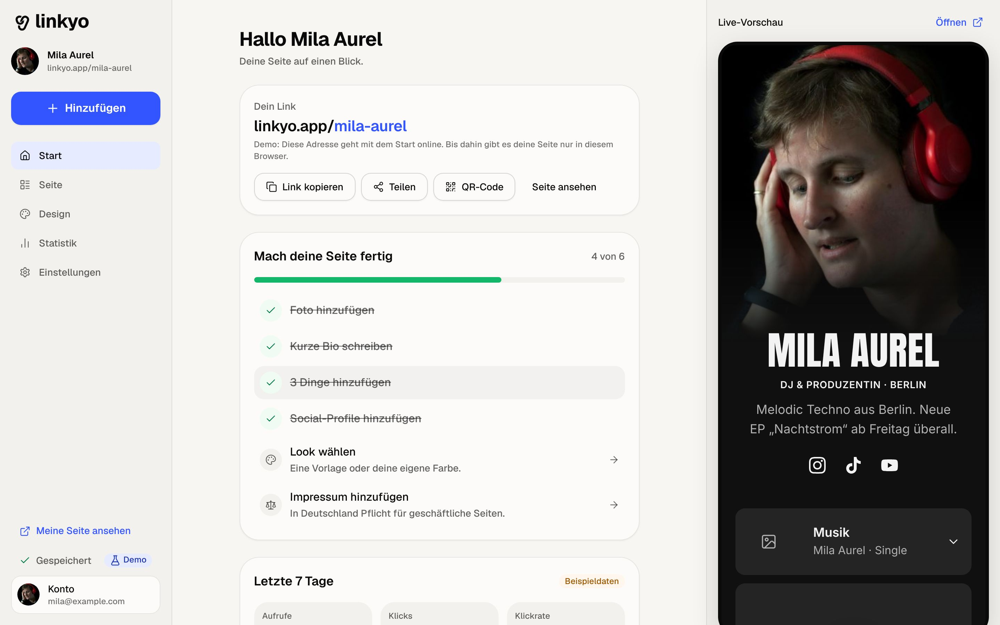 | 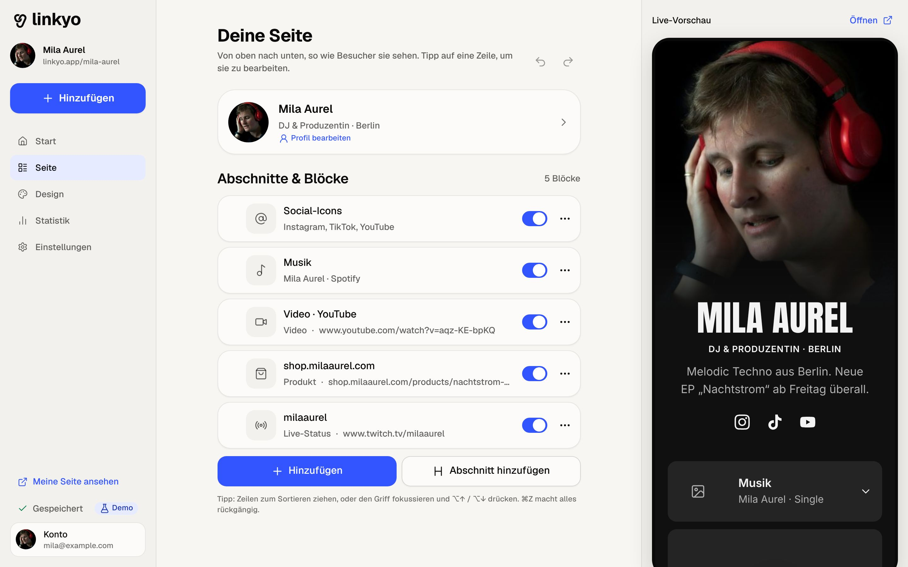 |
| 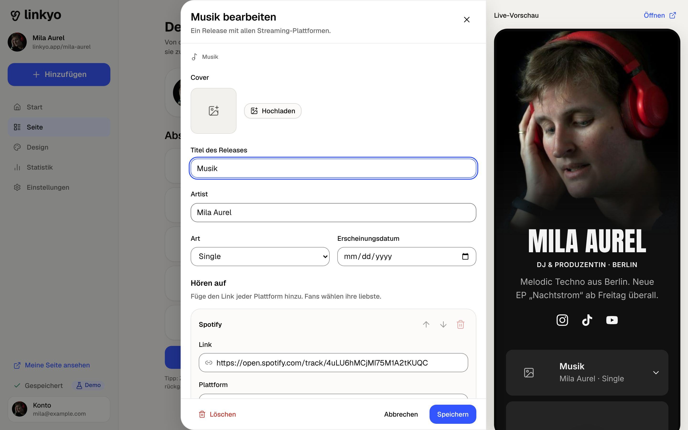 | 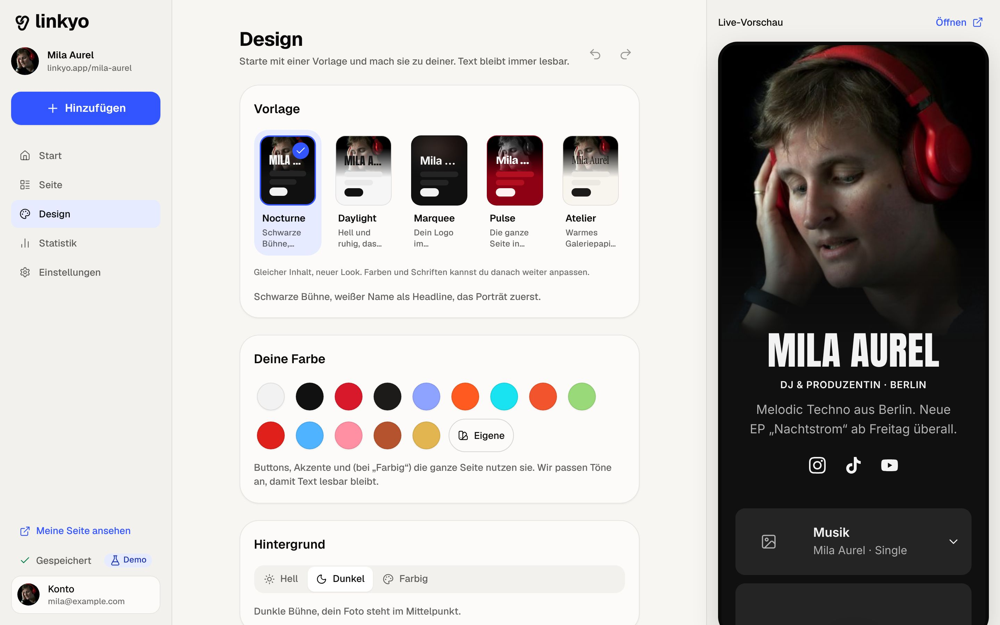 |
| 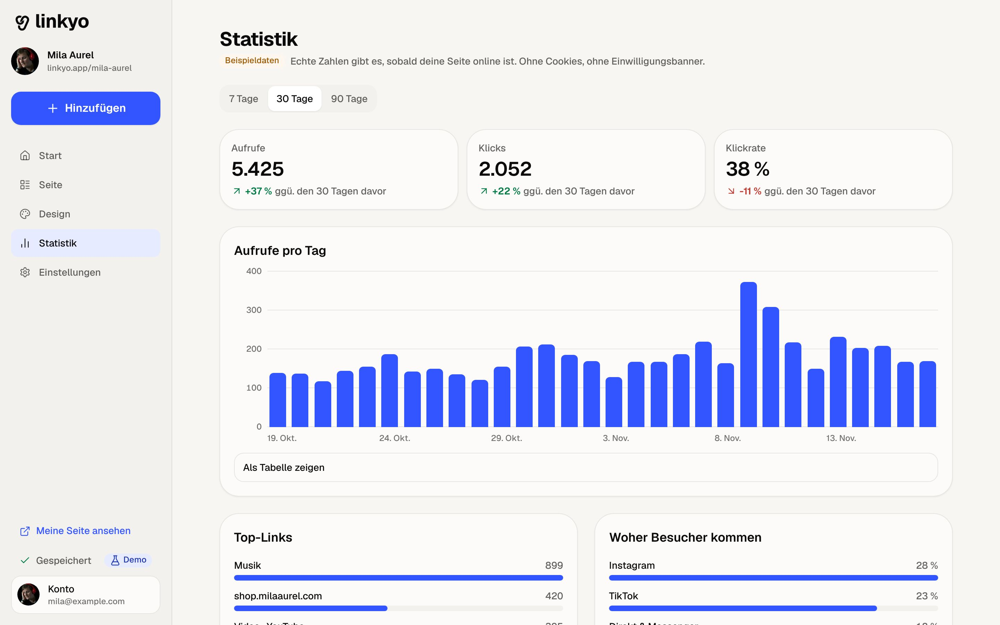 | |

| Phone (ar) | | |
|---|---|---|
| 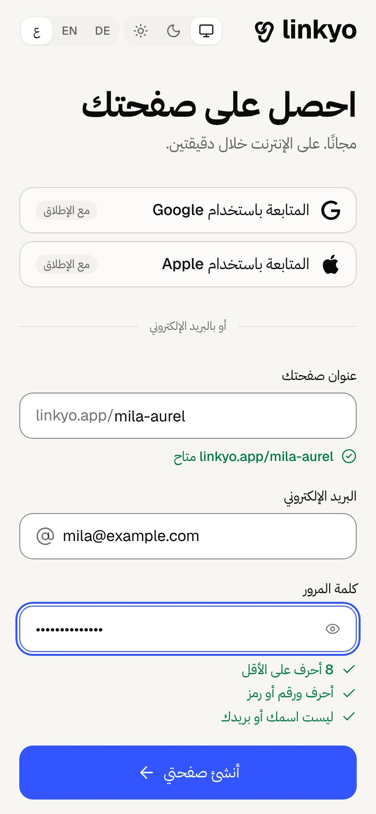 | 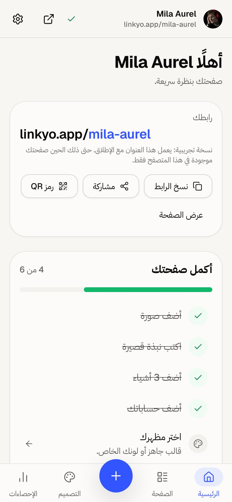 | 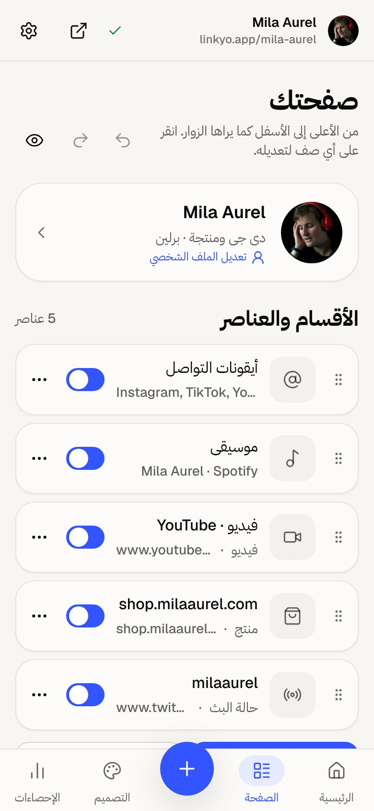 |
| 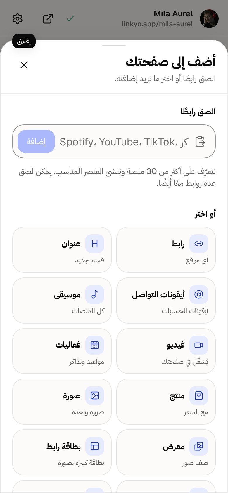 | 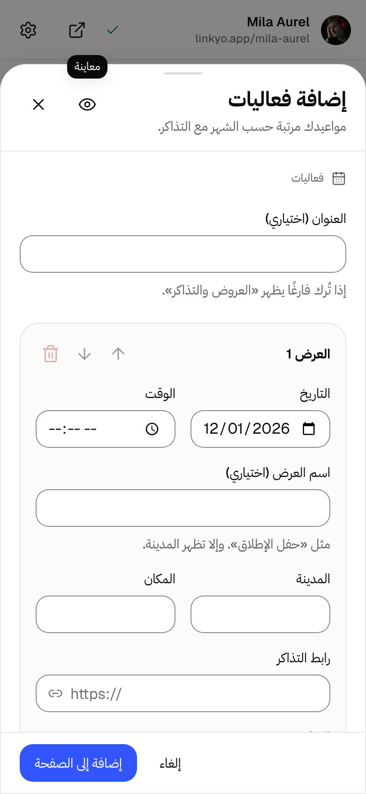 |  |

Tests: account store and validation unit tests (152 unit in total); E2E journeys on desktop and phone (sign-up →
welcome → dashboard → log-out → log-in with return; reset; paste, create with validation, edit, delete + undo, hide,
reload persistence; design; settings persistence; chart keyboard + table); axe clean on all new routes, screens and
sheets. Full suite: 273 passing.

## 1. What was built

| Deliverable | Where | State |
|---|---|---|
| Brand identity (verbatim) | `docs/BRAND_IDENTITY.md` | ✅ |
| Monorepo (pnpm 10, Turborepo 2, TS 6 strict, ESLint 9, Stylelint, Prettier, commitlint + lefthook, CI) | root, `packages/config`, `.github/workflows` | ✅ |
| Tokens → CSS, Tailwind v4 theme, TS, Swift, Asset Catalog (light/dark/Increase Contrast) | `packages/tokens` | ✅ 31 tests |
| Token guard (ESLint rule, Stylelint, SwiftLint rules + Linux CLI, lint-coverage check) | `packages/config` | ✅ 62 tests |
| Logo: "the Loop" symbol, wordmark, lockups, app icons (light/dark/tinted), favicon, native SwiftUI symbol | `packages/tokens/brand` | ✅ generated from geometry |
| Creator theme engine (OKLCH, WCAG AA guard, 12 presets, 8 pairings, 6 styles × 3 shapes, card radius cap, photo seed extraction) | `packages/tokens/src/creator` | ✅ 4,000-seed property test |
| Component library (Button, IconButton+Tooltip, TextField, Switch, Segmented, Badge, Card, Kbd, Avatar, Skeleton, Spinner, Toast w/ Undo, ConfirmDialog, Menu, Logo) | `packages/ui` | ✅ |
| Block schemas (15 types) + smart link detection (YouTube, Spotify, Apple Music, SoundCloud, TikTok, Instagram, Twitch, Eventim, Shopify, email, phone, WhatsApp, PDF, image…) + bulk paste | `packages/blocks` | ✅ 27 tests |
| Living design system page | `/de/design` · `/en/design` · `/ar/design` | ✅ |
| **Direction D "Poster"** (creator page light + dark, section-based dashboard) | `/directions/poster` | ✅ waiting for your confirmation |
| 3 earlier directions (Gallery, Stage, Mosaic), shared editor core: paste-to-add, drag/keyboard reorder, undo/redo, ⌘K, file drop, live preview | `/directions` | ✅ kept for comparison |
| Competitive research | `docs/REFERENCE_ANALYSIS.md` | ✅ (Playwright/Lighthouse/axe — REA blocked, see §5) |
| Accounts + env vars, cost model | `docs/SETUP_ACCOUNTS.md`, `.env.example`, `docs/COSTS.md` | ✅ |
| Architecture + 13 ADRs | `docs/ARCHITECTURE.md`, `docs/DECISIONS/` | ✅ |
| iOS scaffold (XcodeGen, app + Share Extension + Widgets, design-system package, debug Design Gallery, privacy manifest) | `apps/ios` | ⚠ parse-checked only (no Xcode here) |

## 2. Evidence

- **Screenshots** (103): `creator/` (4 directions × de/ar × 375/768/1440; Poster in light and dark; one extra preset
  each), `dashboard/` (× light/dark), `design/`, `overview-*` — this folder. Full-page captures now scroll first so
  lazy images are loaded.
- **Tests:** 138 unit (Vitest) + 213 E2E (Playwright) — all passing.
  - axe (WCAG 2.0/2.1/2.2 A+AA): **0 violations** on 15 routes (incl. all 5 templates) × de/en/ar × light/dark ×
    desktop + mobile.
  - Editor (all 4 dashboards): one paste → correct block + preview update; delete → Undo from toast; ⌘K palette;
    visibility toggle + ⌘Z; ⌥↓ keyboard reorder.
  - Poster: releases open in place with JavaScript disabled; titled sections and two-up shop; links show their
    destination; light and dark have identical structure; "Add section" appears in the preview and is renamed in
    place; the mode switch flips the preview.
  - Privacy: creator pages make **0 third-party requests and set 0 cookies** (asserted, all 4 directions).
- **Lighthouse** (mobile, simulated 4G + 4× CPU; `lighthouse-summary.json`):

| Creator page | Perf | A11y | Best practices | SEO* | LCP | CLS | JS |
|---|---|---|---|---|---|---|---|
| Poster (de, dark) | 88 | 100 | 100 | 63 | 2.4 s | 0.005 | 205 KB |
| Poster (de, light) | 94 | 100 | 100 | 63 | 2.8 s | 0.005 | 205 KB |
| Poster (ar, light) | 84 | 100 | 100 | 63 | 4.1 s | 0.002 | 205 KB |
| Gallery | 99 | 100 | 100 | 63 | 0.9 s | 0.001 | 205 KB |
| Stage | 82 | 100 | 100 | 63 | 4.3 s | 0.028 | 205 KB |
| Mosaic | 88 | 100 | 100 | 63 | 3.9 s | 0 | 205 KB |

\* SEO is 63 only because prototype pages are deliberately `noindex`. Performance moves by up to ±10 between runs on
this machine (Stage scored 93 in the first run with no layout change). On the image-led pages the LCP element is a
17 KB hero image; the delay is main-thread time from the 205 KB App Router bundle. ADR 0008 (static HTML + ~3 KB of
islands for public pages) removes exactly that.

## 3. Rubric (honest, Phase 0 scope)

| # | Criterion | Score | Evidence | To reach 10 |
|---|---|---|---|---|
| 1 | Modernity | 9 | Poster captures light/dark, `/directions` | Your confirmation + scroll-reveal/page-transition polish in Phase 1 |
| 2 | Visual design | 9 | tokens everywhere (lint-enforced), brand followed, Poster in both modes | Tablet (768) dashboard density pass |
| 3 | User experience | 8 | E2E editor + Poster flows | Onboarding (Phase 1), inline editing beyond titles, empty-page first run |
| 4 | Buttons | 10 | `/design#buttons`: 5 variants × 4 sizes × 6 states, 44 pt hit areas | — |
| 5 | Colors | 10 | 4,000-seed AA test, monochrome accents flip per mode, dark/light/high-contrast tokens, ADR 0007 | Sign-off on ADR 0007 |
| 6 | Order / arrangement | 9 | Poster: titled sections, automatic rows/grids, live + newest release first | Validate section defaults with 3–5 creators |
| 7 | Cleanliness | 9 | max 2 font families per page, flat cards, one surface tone | — (prototype toolbar hidden with `?chrome=0`) |
| 8 | Structure (code & IA) | 9 | typed end-to-end, shared schemas, sections as a pure tested function, ADRs, 0 lint errors | Generate `api-client` (Phase 1); delete the 3 earlier directions |
| 9 | Ease of use | 8 | add = 1 paste, sections = 1 click, undo everywhere in editor | Autosave + version history need the backend (Phase 1) |
| 10 | Layout | 9 | 375/768/1440, de + ar RTL, light + dark, 0 horizontal overflow | 320 px and 2560 px passes, iPad |
| 11 | Icons | 10 | Lucide only (stroke 1.75), Simple Icons for platforms (monochrome), SF Symbols on iOS | — |
| 12 | Ease of adding content | 7 | paste/bulk paste/drop (images) in prototype | Metadata fetch, uploads, share sheet, pickers (Phases 1–2) |
| 13 | iOS app quality | 5 | design-system package, Design Gallery, targets, icons, privacy manifest | Phase 2 — first macOS build via `ios.yml` |
| 14 | Performance | 8 | Lighthouse 82–99, CLS ≤ 0.03 | JS 205 → < 70 KB (ADR 0008), LCP < 1.5 s on every page |
| 15 | Accessibility | 10 | axe 0 violations (167 runs incl. Poster light/dark), keyboard reorder, `
` without JS, reduced motion | Manual VoiceOver/TalkBack pass in Phase 1 |
| 16 | Privacy & security | 9 | 0 third-party requests/cookies, no cookie link needed, self-hosted fonts, security headers | RLS + pgTAP, CSP nonces, OWASP review (Phase 1) |

Lines below 10 are either outside Phase 0's scope (backend, iOS build, onboarding) or listed as Phase 1 fixes.

## 4. Open issues / decisions for you

1. **Confirm Poster** (or say what to change). On confirmation, Phase 1 deletes Gallery, Stage and Mosaic.
2. **Sign off ADR 0007** (dark-mode blue roles, status colors as fills, input borders at 3:1).
3. **Music links:** approve dropping Odesli (owned by Linktree) for our own resolver (ADR 0009).
4. **Video provider:** Mux (priced) vs. Bunny Stream (EU company) — ADR 0010.
5. **Logo:** "the Loop" interprets the "y in negative space" as two interlocking links that draw the y — confirm or ask
   for a variant.
6. Lighthouse SEO will be 100 once pages are indexable (production only).

## 5. REA audit summary

REA (`rea-agents`) was reviewed (official npm package, MIT, links to github.com/morluto/rea), but its global install was
**blocked by this session's permission policy**, so it was not installed or run. Equivalent public-page analysis and our
own audit were done with Playwright (HAR/network capture), Chrome DevTools Protocol throttling, Lighthouse 13 and axe-core:
our creator pages make 24–30 same-origin requests, 0 third-party requests, set 0 cookies, and ship 205 KB JS (target 70 KB).

## 6. Costs incurred

None. No accounts were created and no paid services were used. Running cost estimates: `docs/COSTS.md`
(≈ $55/mo pre-launch, ≈ $148 at 1k creators, ≈ $1,135 at 10k).

## 7. Next step

After your confirmation: Phase 1 — Supabase schema + RLS, auth, username claim, the Poster editor on real data with
autosave and version history, metadata fetch + uploads, zero-runtime public renderer (ADR 0008), onboarding, analytics,
legal helper, marketing site (de/en/ar).
